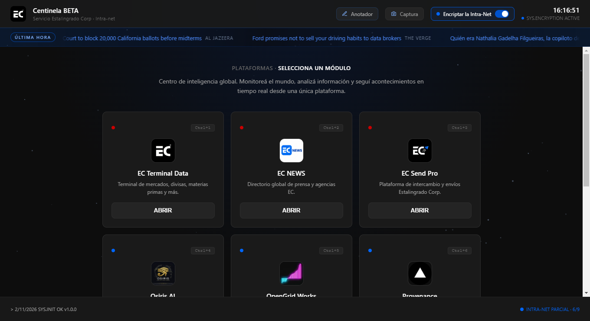
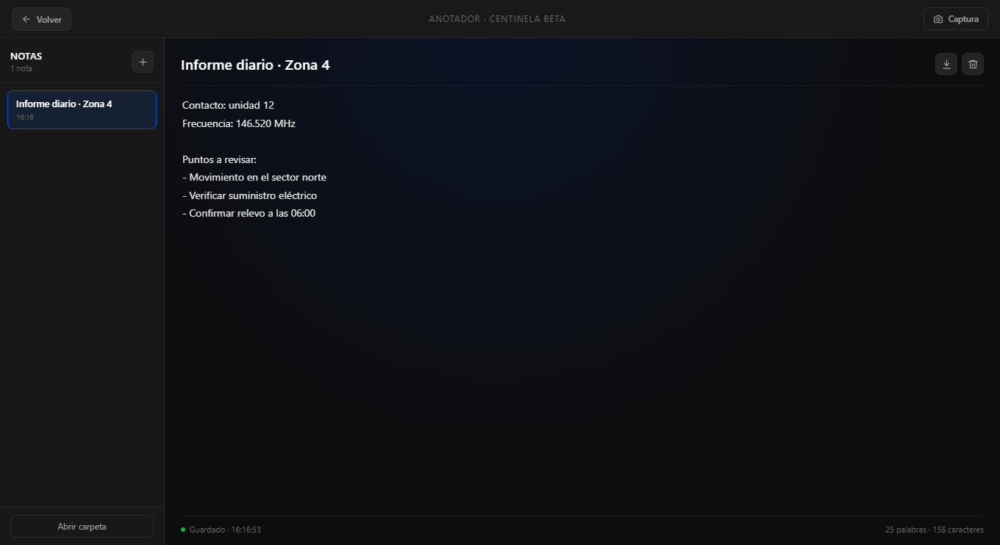
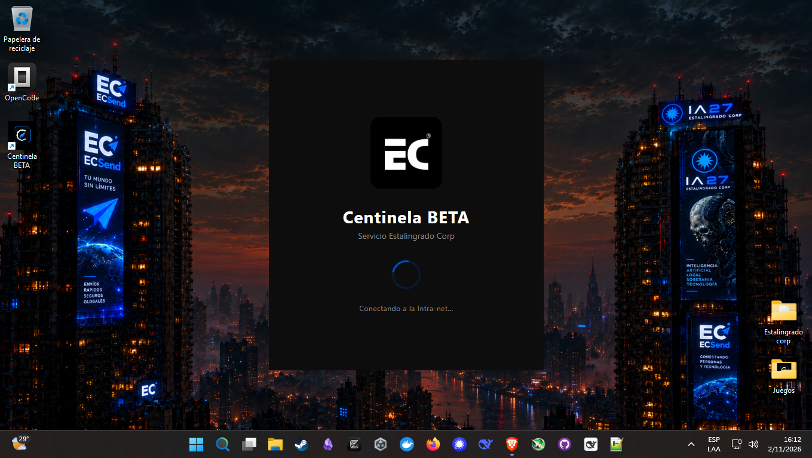
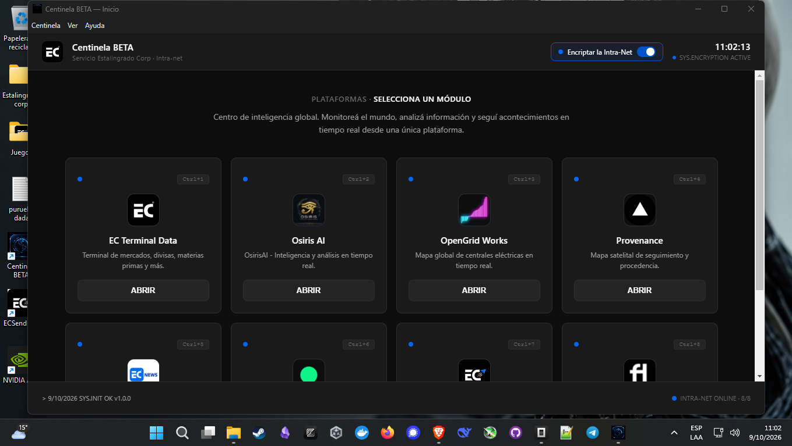

# METATRON

App de escritorio para Windows que abre **nueve plataformas de monitoreo y datos** dentro de un **navegador propio con pestañas**, sin necesidad de un navegador externo. Construida con Electron, con estética **dark tipo terminal Kali Linux**, pantalla de carga con logo de Estalingrado Corp y bloqueo de anuncios integrado.

---

## Tabla de contenidos

1. [Descripción](#descripción)
2. [Capturas de pantalla](#capturas-de-pantalla)
3. [Características](#características)
4. [Navegador de pestañas](#navegador-de-pestañas)
5. [Anotador: datos y copias de seguridad](#anotador-datos-y-copias-de-seguridad)
6. [Plataformas](#plataformas)
7. [Estructura del proyecto](#estructura-del-proyecto)
8. [Requisitos](#requisitos)
9. [Puesta en marcha (desarrollo)](#puesta-en-marcha-desarrollo)
10. [Generar el instalador](#generar-el-instalador)
11. [Distribución](#distribución)
12. [Solución de problemas](#solución-de-problemas)

---

## Descripción

**METATRON** es un *wrapper* de escritorio construido con [Electron](https://www.electronjs.org/). Su propósito es ofrecer acceso rápido y autónomo a **nueve plataformas** de monitoreo de inteligencia y datos, con todo dentro de una sola ventana.

Características principales:

- **Navegador propio con pestañas**: cada plataforma se abre como una pestaña, con barra de direcciones, historial (atrás/adelante), recarga y zoom.
- Cada web se renderiza en una **vista aislada** (`WebContentsView`) que se reengancha al activar su pestaña, conservando estado, scroll y formularios.
- **Lanzador de módulos** con tarjetas para abrir la primera pestaña.
- **Menú nativo** reorganizado en 4 secciones para liberar espacio: METATRON, Ver, Herramientas y Ayuda.
- Estética **dark tipo terminal Kali Linux** (fondo casi negro, monoespaciada, acentos azul/verde/rojo/cian).
- Muestra una pantalla de carga animada mientras las webs se conectan.
- Reenvía los enlaces externos (que no sean de las webs permitidas) al navegador del sistema.
- Se instala como programa normal de Windows (con acceso directo en escritorio e inicio).

---

## Capturas de pantalla

### Pantalla de inicio



Vista principal (lanzador de módulos) con las 9 plataformas, el teleprompter de última hora, el reloj, el estado de conexión, los accesos **Anotador** y **Captura**, y el interruptor **Encriptar la Intra-Net**, todo bajo la barra de pestañas y la barra de direcciones estilo terminal Kali.

### Navegador de pestañas


Barra de pestañas con favicon y nombre de cada plataforma, botón `+` para nueva pestaña, barra de direcciones con indicador `SECURE`, y debajo la vista de la web activa.

### Anotador



Bloc de notas integrado como **pestaña del navegador** (Ctrl+N): varias notas, autoguardado, buscador, notas fijadas, contador de palabras/caracteres, exportación individual o masiva a `.txt`, importación de copias y restauración automática.

### Pantalla de carga



Splash con el logo de Estalingrado Corp y el texto *"Conectando a la Intra-net…"*.

<details>
<summary>Captura anterior (09/10/2026)</summary>



</details>

---

## Características

- **Navegador con pestañas integrado**: barra de pestañas (nombre de la página + favicon + botón `×`), barra de direcciones con indicador de estado (`OSINT` / `SECURE` / `WEB` / `HIST` / `LOCAL`), y navegación real (atrás, adelante, recarga, recarga sin caché, zoom, DevTools).
- **Cajón OSINT**: todas las páginas viven en un cajón desplegable (botón **OSINT** en la barra o Ctrl+Shift+O) con la **página de inicio `https://estalingradocorp.com.ar/`**, las 9 plataformas y **las webs que agregás vos**. Cada entrada muestra ícono, nombre, host y estado online/offline; con un clic se abre en una pestaña.
- **Agregar webs**: el formulario **AGREGAR WEB** del cajón permite cargar cualquier URL con un nombre; se guardan en `%APPDATA%\METATRON\paginas.json` y se pueden quitar con la `×` de la tarjeta.
- **Arranque con la home**: METATRON abre siempre con `https://estalingradocorp.com.ar/` cargada en una pestaña y el cajón OSINT desplegado al costado.
- **Vista dedicada por página** (`WebContentsView`): cada sitio se renderiza en su propia vista aislada, con mejor rendimiento y sin recargar el lanzador. La ventana principal (1280×800, mínimo 800×600) arranca en **pantalla completa**.
- **User-Agent de Chrome 124** (`session.defaultSession.setUserAgent`): evita que Cloudflare y otros sitios anti-bot bloqueen a Electron.
- **Estética dark tipo Kali Linux** en toda la interfaz: fondo `#07090c`, paneles `#0d1014`/`#141920`, líneas `#232a33`, acentos azul `#367bf0`/`#5b9bff`, verde `#35d07f`, rojo `#ff4d4f`, amarillo `#e3b341` y cian `#3fc9d4`; tipografía monoespaciada (`JetBrains Mono`/`Fira Code`/`Cascadia Mono`/`Consolas`), bordes rectos y prompt `root@metatron:`.
- **Barra de direcciones libre**: cualquier sitio (no sólo las 9 plataformas) se abre **dentro del navegador de METATRON**. Si hay una pestaña de web activa se navega en ella; si no, se abre una pestaña nueva. **Nunca** se delega al navegador del sistema.
- **Teleprompter de última hora** en la parte inferior del lanzador: cinta de titulares que se desplaza, alimentada por RSS de **Google News, BBC Mundo, BBC News, El País, Al Jazeera, NBC News, The Verge y TechCrunch** (descarga en el proceso principal, refresco cada 10 min, máximo 24 titulares). Los titulares van en **azul** y los que coinciden con señales de urgencia (*URGENTE, breaking news, alerta máxima, estado de emergencia, evacuación, explosión, terremoto, atentado, tiroteo, víctimas…*) en **rojo** con distintivo `URGENTE`. Clic en un titular → abre la noticia en el navegador. Sin conexión, la cinta muestra *SIN SEÑAL*.
- **Monitoreo de conectividad** por plataforma mediante peticiones `HEAD` con `AbortController` (timeout 5 s), con reintento y estado agregado en el pie (*INTRA-NET ONLINE / PARCIAL / SIN CONEXIÓN*).
- **Opción "Sobre el programa"** en el menú **Ayuda** (F1): modal con la info de METATRON, la descripción y un botón que abre la web de Estalingrado Corp (`estalingradocorp.qzz.io`).
- **Anotador** como **pestaña de herramienta** (Ctrl+N o menú **Herramientas**): varias notas, autoguardado local, **buscador** (Ctrl+F), **notas fijadas**, contador de palabras/caracteres, **exportación individual** (`.txt`), **exportación de todas las notas** (Ctrl+Shift+E), **importación de copias de seguridad**, **restauración de la última copia**, **apertura de la carpeta de datos**. Al cerrar la pestaña se ejecuta un guardado sincrónico (`window.__anotadorFlush()`) para no perder lo último tipeado.
- **Capturas de pantalla** (menú **Ver** o botón **Captura**, Ctrl+Shift+S): captura la ventana completa de METATRON (incluida la vista activa), la guarda en `Imágenes\METATRON Capturas` y la copia al portapapeles.
- **Menú nativo** reorganizado en 4 secciones, sin las 9 plataformas (ahora viven como pestañas) para liberar espacio:
  - **METATRON**: Página de inicio (Ctrl+H), Nueva pestaña (Ctrl+T), Cajón OSINT (Ctrl+Shift+O), Cerrar pestaña (Ctrl+W), Pestaña siguiente/anterior (Ctrl+Tab / Ctrl+Shift+Tab), Salir.
  - **Ver**: Recargar (Ctrl+R), Recargar sin caché (Ctrl+Shift+R), Atrás/Adelante, Zoom, DevTools (F12), Pantalla completa (F11), carpeta de capturas.
  - **Herramientas**: Anotador (Ctrl+N), Captura (Ctrl+Shift+S), carpeta de notas, Restaurar copia de notas, Encriptar la Intra-Net, Vaciar caché.
  - **Ayuda**: "Sobre el programa" (F1), accesos a las plataformas y a la página de inicio.
- **Atajos de plataforma** **Ctrl+1 … Ctrl+9** registrados globalmente (`before-input-event`), así funcionan con cualquier pestaña activa.
- **Pantalla de carga (splash)** con logo, título y texto *"Conectando a la Intra-net…"* con spinner circular.
- **Carga en paralelo**: la web se carga en segundo plano mientras se muestra el splash, con transición al terminar (mínimo 1,8 s).
- **Seguridad de navegación**: las vistas se aislan del proceso principal (`contextIsolation`, `sandbox`, sin Node) y el bloqueo de anuncios se aplica a todas; los enlaces se abren **siempre dentro de la app**.
- **Bloqueo de anuncios** (listas EasyList + EasyPrivacy con caché local).
- **Aislamiento de procesos**: `contextIsolation: true`, `nodeIntegration: false` y `sandbox: true` en las vistas de sitio.
- **Instalador NSIS** con asistente, selección de carpeta y accesos directos. **No borra los datos de la app al desinstalar** (`deleteAppDataOnUninstall: false`).

---

## Navegador de pestañas

Todas las páginas viven dentro de **una sola ventana**, como un navegador propio.

### Cómo funciona

- Cada pestaña conserva su `WebContentsView`: al cambiar de pestaña la vista se **desengancha** (`setVisible(false)`) y al activarse se **reengancha** en la posición correcta, conservando scroll, formularios y sesión.
- La barra de pestañas, la barra de direcciones y el **cajón OSINT** viven en `home.html`. El renderizador informa el **alto real** de la barra por IPC (`chrome:height`) y el proceso principal posiciona las vistas justo debajo (`y = chromeHeight`). Al abrir o cerrar el cajón, el alto se recalcula y la web se acomoda sola.
- El **título de la pestaña** muestra el nombre de la página (por ejemplo *Radio Garden*); el título real de la página queda en el tooltip.
- Cuando no queda ninguna pestaña abierta se ve el estado vacío con el acceso al cajón.

### Atajos

| Atajo | Acción |
| --- | --- |
| Ctrl+T | Nueva pestaña (abre la página de inicio) |
| Ctrl+W | Cerrar pestaña activa |
| Ctrl+Tab / Ctrl+Shift+Tab | Pestaña siguiente / anterior |
| Ctrl+H | Página de inicio (`estalingradocorp.com.ar`) |
| Ctrl+Shift+O | Abrir / cerrar el cajón OSINT |
| Ctrl+L | Foco en la barra de direcciones |
| Ctrl+R / Ctrl+Shift+R | Recargar / recargar sin caché |
| Ctrl+1 … Ctrl+9 | Abrir la plataforma correspondiente en una pestaña |
| Ctrl+N | Anotador (pestaña de herramienta) |
| Ctrl+Shift+S | Captura de pantalla |
| F11 / F12 | Pantalla completa / DevTools |

### Reglas de navegación

- La barra de direcciones acepta **cualquier URL**: se abre dentro de METATRON, en la pestaña activa o en una pestaña nueva.
- Los links que piden una ventana nueva (`target="_blank"`, `window.open`) se abren como **pestaña interna**, nunca en el navegador del sistema.
- La navegación dentro de una pestaña es libre (como en un navegador); si la pestaña estaba en una plataforma y se navega a otro sitio, pasa a ser una "web libre" (icono de globo, bandera `WEB`).
- Las noticias del teleprompter, los links del menú Ayuda y el botón "Visitar Estalingrado Corp" también abren **pestañas internas**.
- El botón **×** de cada pestaña la cierra; en la pestaña del anotador se guarda el contenido antes de destruirla.
- Protocolos que no son web (`mailto:`, `file:`, etc.) se bloquean con un aviso.

---

## Anotador: datos y copias de seguridad

> **Objetivo crítico:** el contenido de las notas **nunca debe perderse al reinstalar** METATRON.

### Dónde se guardan las notas

| Qué | Ruta |
| --- | --- |
| Datos del anotador | `%APPDATA%\METATRON\notas\` |
| Archivo principal (JSON) | `%APPDATA%\METATRON\notas\anotador.json` |
| Espejo legible (texto plano) | `%APPDATA%\METATRON\notas\notas.txt` |
| Copias de seguridad automáticas | `%APPDATA%\METATRON\notas\copias\` |

Las notas viven **fuera** de la carpeta de datos de Electron (`%APPDATA%\metatron`), porque el desinstalador NSIS borra esa carpeta por defecto. Como segunda barrera, el instalador se compila con `nsis.deleteAppDataOnUninstall: false`.

### Funciones de protección

- **Autoguardado** con debounce de 500 ms y **guardado sincrónico** al cerrar la app o el anotador (`beforeunload`).
- **Escritura atómica**: se escribe un `.tmp` y se renombra, así un cierre abrupto no deja el JSON corrupto.
- **Espejo en texto plano** (`notas.txt`) regenerado en cada guardado: siempre se puede leer el contenido fuera de la app.
- **Copias de seguridad automáticas**: una por minuto como máximo, conservando las **20 más recientes** en `notas\copias\`.
- **Restauración automática**: si `anotador.json` está vacío o corrupto al abrir la app, se recupera desde la última copia válida.
- **Migración transparente**: las notas de las versiones anteriores se migran solas a la nueva ubicación y el archivo viejo queda respaldado en `notas\copias\migracion-*.json`:
  - `%APPDATA%\centinela-beta\anotador.json` (primera versión del anotador)
  - `%APPDATA%\Centinela\notas\` (versión Centinela BETA, con `anotador.json`, `notas.txt` y `copias\`)
- **Importar / restaurar** desde la interfaz: `Importar` fusiona un `.json` de copia con las notas actuales y `Restaurar copia` recupera la última copia automática.

### Datos del cajón OSINT

| Qué | Ruta |
| --- | --- |
| Páginas agregadas por el usuario | `%APPDATA%\METATRON\paginas.json` |

El archivo se escribe de forma atómica (`.tmp` + rename) y sólo guarda las páginas que agregás vos: la página de inicio y las 9 plataformas son fijas y no se pueden borrar.

### Atajos del anotador

| Atajo | Acción |
| --- | --- |
| Ctrl+N | Abrir el anotador como pestaña |
| Ctrl+Shift+N | Nueva nota |
| Ctrl+F | Buscar en las notas |
| Ctrl+S | Guardar ahora |
| Ctrl+Shift+E | Exportar todas las notas a `.txt` |
| Esc | Limpiar la búsqueda / cerrar la pestaña del anotador |

> Para una copia de seguridad manual: **Exportar .txt** (texto plano) o **Abrir carpeta** → copiar `anotador.json` a un Pendrive o a la nube.

---

## Plataformas

| Atajo | Plataforma | URL |
| --- | --- | --- |
| Ctrl+1 | EC Terminal Data | https://nicotips27.github.io/Estalingrado-corp-Terminal-data/ |
| Ctrl+2 | EC NEWS | https://nicotips27.github.io/ECnews/ |
| Ctrl+3 | EC Send Pro | https://estalingradocorp.github.io/ECsendpro/ |
| Ctrl+4 | Osiris AI | https://osirisai.live/ |
| Ctrl+5 | OpenGrid Works | https://opengridworks.com/power-plants |
| Ctrl+6 | Provenance | https://provenance-online.com/app?lat=5.6961&lon=-52.32892&z=1.74&layers=&base=satellite |
| Ctrl+7 | Radio Garden | https://radio.garden/ |
| Ctrl+8 | Famelack | https://famelack.com/ |
| Ctrl+9 | Drive & Listen | https://driveandlisten.app/ |

> Provenance abre su mapa satelital con una configuración concreta (lat/lon, zoom y capas).

---

## Estructura del proyecto

```
Estalingradocorp-METATRONEC/
├── package.json        # Configuración del proyecto, scripts y electron-builder
├── package-lock.json   # Bloqueo de dependencias (generado)
├── main.js             # Proceso principal: pestañas, WebContentsView, menú nativo, navegación segura e IPC
├── preload.js          # Puente seguro entre el renderizador y Node (API del navegador)
├── renderer.html       # Página de respaldo (poco usada)
├── splash.html         # Pantalla de carga con el logo y el texto
├── home.html           # Shell del navegador: barra de pestañas, barra de direcciones y lanzador de módulos
├── notes.html          # Anotador: bloc de notas con autoguardado y exportación
├── notes-preload.js    # Puente seguro del anotador (cargar / guardar / exportar)
├── logo.jpg            # Logo de Estalingrado Corp (splash, tarjeta EC Terminal Data)
├── img-ecnews.jpg      # Imagen de la tarjeta EC NEWS
├── img-osiris.png      # Imagen de la tarjeta Osiris AI
├── img-opengrid.webp   # Imagen de la tarjeta OpenGrid Works
├── img-warwatch.png    # Imagen de la tarjeta Provenance
├── img-ecsendpro.png   # Imagen de la tarjeta EC Send Pro
├── img-radiogarden.png   # Imagen de la tarjeta Radio Garden
├── img-famelack.png      # Imagen de la tarjeta Famelack
├── img-driveandlisten.png # Imagen de la tarjeta Drive & Listen
├── img-palantir.png    # Imagen de la tarjeta Palantir
├── img-conflictradar.png # Icono de la tarjeta Conflict Radar 360
├── img-worldmonitor.png  # Icono de la tarjeta World Monitor
├── Imagenes/Iconos/icono/icono.png # Icono maestro (1254×1254, fuente del app icon)
├── Imagenes/demostracion/ # Capturas de pantalla usadas en este README
├── icon.png            # Icono de la app (256×256, generado desde el maestro)
├── icon.ico            # Icono del instalador NSIS (generado desde el maestro)
├── make-icon.js        # Script que regenera icon.png e icon.ico
├── adblock.js          # Bloqueo de anuncios con caché local
├── node_modules/       # Dependencias (generado por npm)
└── dist/               # Instaladores generados (resultado del build)
    └── METATRON Setup 1.0.0.exe
```

### Descripción de archivos clave

| Archivo | Rol |
| --- | --- |
| `main.js` | Proceso principal de Electron. Define las webs, construye el menú nativo (METATRON / Ver / Herramientas / Ayuda), crea el splash y la ventana principal, gestiona las **pestañas** (`WebContentsView` por pestaña, attaching/detaching, layout bajo la barra del navegador) y el IPC. |
| `home.html` | Shell del navegador: barra de pestañas, barra de direcciones, **cajón OSINT** (páginas integradas + las que agregás), reloj, estado de conexión, interruptor de encriptación, teleprompter de noticias y toast. |
| `notes.html` | Anotador: bloc de notas integrado como pestaña de herramienta, con lista, buscador, notas fijadas, autoguardado, contador, exportación/importación/restoración y ruta de datos en el pie. Expone `window.__anotadorFlush()` para guardar antes de cerrar la pestaña. |
| `notes-preload.js` | Puente seguro del anotador (`window.anotador.{load,save,saveSync,exportNote,exportAll,importBackup,backups,restore,dataPath,openFolder,close,capture}`). |
| `splash.html` | Pantalla de carga: logo, título, subtítulo y texto de conexión con spinner CSS. |
| `preload.js` | Puente seguro del navegador (`window.metatron.{getTabs,onTabs,activateTab,closeTab,newTab,cycleTab,go,focusUrl,back,forward,reload,home,setChromeHeight,setEncryption,onToast,onFocusUrl,onEncryption,capture,getPages,onPages,addPage,removePage,openPage,onDrawerToggle}`) entre el renderizador y el proceso principal, con inyección de estilos base. |
| `adblock.js` | Inicializa el bloqueo de anuncios (`@cliqz/adblocker`) con listas EasyList/EasyPrivacy y caché local. |
| `package.json` | Define nombre, versión, scripts (`start`, `dist`), archivos empaquetados y configuración de electron-builder. |
| `make-icon.js` | Regenera `icon.png` (256×256) e `icon.ico` desde el icono maestro `Imagenes/Iconos/icono/icono.png`. Requiere `npm install` (usa `app-builder`). |

---

## Requisitos

- **Sistema operativo:** Windows 10/11 de 64 bits (para el instalador generado).
- **Node.js** v18 o superior (para desarrollo y compilación). Probado con Node v24.
- **npm** (incluido con Node).

> El instalador generado **no** requiere Node ni Electron instalados en los equipos destino: es un ejecutable autocontenido.

---

## Puesta en marcha (desarrollo)

Desde la carpeta del proyecto:

```powershell
# 1. Instalar dependencias
npm install

# 2. Ejecutar la app en modo desarrollo (ventana de depuración)
npm start
```

Si al instalar dependencias Electron no descarga su binario (política de scripts seguros), asegúrate de que `package.json` contenga:

```json
"allowScripts": {
  "electron": "postinstall"
}
```

y vuelve a ejecutar `npm install`.

---

## Generar el instalador

```powershell
npm run dist
```

O directamente:

```powershell
npx electron-builder --win
```

El resultado queda en `dist/`:

```
dist/
└── METATRON Setup 1.0.0.exe   ← instalador final
```

### Notas sobre el build

- **Icono:** electron-builder convierte `icon.png` (256×256) a `.ico` automáticamente.
- **Primer build:** descarga las herramientas NSIS, así que la primera compilación tarda más.
- **Versión:** el nombre del instalador incluye la `version` de `package.json`. Auméntala (`npm version patch`) antes de publicar una nueva build.

### Regenerar el icono de la app

El icono maestro vive en `Imagenes/Iconos/icono/icono.png` (1254×1254). Para aplicarlo al app:

```powershell
node make-icon.js
```

Esto regenera `icon.png` (256×256, para el `.exe` y la barra de tareas) e `icon.ico` (256×256, para el instalador NSIS). Después hay que reconstruir el instalador:

```powershell
npm run dist
```

---

## Distribución

El instalador es un **programa de uso interno** que no está firmado digitalmente:

1. Copia `dist\METATRON Setup 1.0.0.exe` al equipo destino.
2. Ejecútalo. Windows mostrará el aviso *"Editor desconocido"*:
   - Pulsa **Más información** → **Ejecutar de todos modos**.
3. Sigue el asistente (elige carpeta y accesos directos).
4. La app queda en Inicio y en el Escritorio.

> **Firma de código:** para eliminar el aviso de Windows necesitas un certificado de firma (coste). No es necesario para uso interno.

---

## Solución de problemas

| Problema | Solución |
| --- | --- |
| Aviso azul "Editor desconocido" al instalar | Normal sin firma: **Más información → Ejecutar de todos modos**. |
| La app no muestra la web (pantalla en blanco) | Verifica la conexión a las plataformas y que el sitio esté en línea. |
| Un sitio muestra un aviso de Cloudflare | Verifica que el User-Agent de Chrome 124 se aplique (`session.defaultSession.setUserAgent`). |
| El teleprompter muestra *SIN SEÑAL* | Sin conexión a internet: el proceso principal no pudo descargar los RSS de las agencias. |
| No bloquea anuncios la primera vez | La primera ejecución necesita internet para descargar las listas EasyList/EasyPrivacy y guardarlas en caché. |
| El splash se queda mucho tiempo | Es por red de seguridad; la app fuerza la transición a los ~11,8 s máx. |
| Electron no descarga el binario al `npm install` | Revisa la clave `allowScripts` en `package.json`. |
| No aparecen las notas después de reinstalar | Las notas están en `%APPDATA%\METATRON\notas\` (fuera de la carpeta que borra el desinstalador). Abrí **Anotador → Abrir carpeta** y verificá que exista `anotador.json`; si falta, usá **Restaurar copia** o **Importar**. |
| La carpeta está en OneDrive y da errores al compilar | OneDrive bloquea archivos en uso. Mueve el proyecto a una ruta local (p. ej. `C:\dev\metatron`). |

---

## Changelog

### v1.0.0
- App inicial *Conflict Radar 360*.
- Renombrado a **METATRON**.
- Pantalla de carga con logo y texto de la Intra-net.
- Icono y empaquetado NSIS.
- Bloqueo de anuncios (EasyList + EasyPrivacy).
- Menú nativo: se añade **World Monitor** y atajos de cambio de web (Ctrl+1 / Ctrl+2).
- **Pantalla de inicio** con tarjetas para elegir cada web (Ctrl+H / menú METATRON).
- Se añaden **EC NEWS**, **EC Terminal Data** y **Radio Garden** (Ctrl+4, Ctrl+5, Ctrl+6).
- **"Sobre el programa"** movido al menú Ayuda con enlace a Estalingrado Corp.
- **Logo de Estalingrado Corp** y tema de interfaz **azul/negro**.
- **Interruptor "Encriptar la Intra-Net"** junto al reloj.
- **Imágenes personalizadas** en las tarjetas de Palantir, EC NEWS y EC Terminal Data.
- Se añaden **EC Send Pro** y **Famelack** (Ctrl+7, Ctrl+8).
- **Ventana nativa de Windows** con menú clásico siempre visible (METATRON, Ver, Ayuda).
- Se añade **War Watch** junto a Palantir (Ctrl+2) y se mejoran los iconos de todas las plataformas con sus favicons oficiales.
- **Arquitectura `WebContentsView`**: cada plataforma se renderiza en una vista aislada, con mejor rendimiento y gestión de vistas pendientes/cargadas.
- **User-Agent de Chrome 124** aplicado a la sesión por defecto para evitar bloqueos anti-bot (Cloudflare).
- **Pantalla completa por defecto** al abrir la app.
- **Fondo de estrellas animado** (canvas 2D) en la pantalla de inicio, con soporte `prefers-reduced-motion`.
- **Toggle "Encriptar la Intra-Net"** funcional: LED e indicadores de red cambian a azul y el estado pasa a *SYS.ENCRYPTION ACTIVE*.
- **Monitoreo de conectividad** por plataforma vía `HEAD` con timeout de 5 s, con estado agregado (*ONLINE / PARCIAL / SIN CONEXIÓN*) en el pie.
- **Splash más rápido** (mínimo 1,8 s) con spinner circular y rediseño del *renderer.html*.
- Se retiran **Palantir**, **War Watch**, **Conflict Radar 360** y **World Monitor**; entran **Osiris AI**, **OpenGrid Works** y **Provenance**.
- **Nuevo icono de la app**: "C" con aguja de brújula sobre fondo oscuro con borde azul. Se aplica al `.exe`, a la barra de tareas y al instalador NSIS. El pipeline queda en `make-icon.js` (lee `Imagenes/Iconos/icono/icono.png`).
- **Nueva plataforma: Drive & Listen** (Ctrl+9) — recorridos virtuales por 100+ ciudades con radio local. Grid de inicio ajustado a 3 columnas (3×3).
- **Teleprompter de última hora** en el inicio (RSS de 8 agencias, titulares en azul y en rojo cuando son urgentes, clic para abrir la noticia).
- **Orden de plataformas reordenado**: EC NEWS (Ctrl+2) junto a EC Terminal Data (Ctrl+1) y EC Send Pro (Ctrl+3) justo después.
- **27/10/2026: se elimina el módulo METATRON Globe (WorldWideView)** de la app: tarjeta, atajo Ctrl+0, menú, loader `globe.html`, `globe-preload.js` y toda la lógica de Docker/auto-login. La app queda con 9 plataformas (Ctrl+1–9). El proyecto `..\worldwideview` y su instancia Docker quedan intactos en disco, fuera de METATRON.
- **02/11/2026: Anotador** en el menú **METATRON** (Ctrl+N) y botón en la cabecera del inicio: vista interna (no abre ventana ni saca de pantalla completa), varias notas, autoguardado en `%APPDATA%\metatron\anotador.json`, contador de palabras/caracteres, exportación a `.txt` y acceso a la carpeta de datos.
- **02/11/2026: Capturas de pantalla** en el menú **Ver** (Ctrl+Shift+S) y botón **Captura** en el inicio: guarda la ventana completa de METATRON en `Imágenes\METATRON Capturas` y la copia al portapapeles.
- **18/11/2026: Anotador v2 — las notas ya no se pierden al reinstalar.** Los datos se movieron fuera de la carpeta que borra el desinstalador: ahora viven en `%APPDATA%\METATRON\notas\` (`anotador.json` + espejo `notas.txt` + `copias\`). El instalador se compila con `nsis.deleteAppDataOnUninstall: false`. Se agregaron **buscador** (Ctrl+F), **notas fijadas**, **exportar todas las notas a .txt** (Ctrl+Shift+E), **importar copia de seguridad**, **restaurar la última copia**, **abrir carpeta** y la **ruta de datos visible en el pie**. Además: escritura atómica, autoguardado 500 ms, guardado sincrónico al cerrar, copias de seguridad automáticas (20 últimas, una por minuto), restauración automática si el JSON se corrompe y migración transparente desde la ubicación anterior.
- **25/11/2026: Rediseño tipo Kali Linux + navegador de pestañas.** Toda la interfaz pasa a una estética **dark de terminal** (fondo `#07090c`, monoespaciada, acentos azul/verde/rojo/cian, prompt `root@metatron:`). Las 9 plataformas dejan de estar en el menú nativo y pasan a **pestañas dentro de una sola ventana**, con barra de pestañas, barra de direcciones, navegación real (atrás/adelante/recarga/zoom) y vistas `WebContentsView` que se reenganchan conservando estado. El **Anotador** pasa a ser una pestaña de herramienta (se guarda de forma sincrónica al cerrarla). El menú nativo se reorganiza en 4 secciones (**METATRON**, **Ver**, **Herramientas**, **Ayuda**) para liberar espacio. Los atajos **Ctrl+1 … Ctrl+9** se registran globalmente con `before-input-event` para que sigan funcionando con cualquier pestaña activa.
- **25/11/2026: METATRON pasa a ser el único navegador.** La barra de direcciones acepta cualquier URL y navega **dentro de la app** (en la pestaña activa o en una nueva); los links que piden una ventana nueva (`target="_blank"`) abren pestañas internas; las noticias del teleprompter, los links del menú Ayuda y el botón "Visitar Estalingrado Corp" también. **Se eliminó todo uso de `shell.openExternal`**: el navegador del sistema ya no se usa para navegar. Las pestañas de plataformas que se navegan a otro sitio pasan a "web libre" (icono de globo, bandera `WEB`).
- **26/11/2026: Renombrado a METATRON + cajón OSINT.**
  - La app pasa de **Centinela BETA** a **METATRON**: nombre del producto, título de ventana, menú, splash, instalador (`METATRON Setup 1.0.0.exe`), accesos directos, carpeta de capturas (`Imágenes\METATRON Capturas`) y puente del renderizador (`window.metatron`).
  - El lanzador de módulos se reemplaza por el **cajón OSINT**: un panel desplegable (botón **OSINT** / Ctrl+Shift+O) que contiene **todas** las páginas — la página de inicio `https://estalingradocorp.com.ar/`, las 9 plataformas y **las webs que agrega el usuario**.
  - **Agregar webs**: el formulario **AGREGAR WEB** guarda cualquier URL en `%APPDATA%\METATRON\paginas.json`; la `×` de la tarjeta la quita del cajón.
  - **La app abre con la home**: `https://estalingradocorp.com.ar/` queda cargada en una pestaña y el cajón OSINT desplegado al costado (el alto de la barra se recalcula por IPC y la web se acomoda debajo).
  - **Notas migradas**: `%APPDATA%\METATRON\notas\` es la nueva ubicación; las notas de `%APPDATA%\Centinela\notas\` (con su espejo en texto plano y sus copias) se migran solas y el archivo original queda respaldado en `notas\copias\migracion-centinela-*.json`.
  - El **atajo Ctrl+1 … Ctrl+9** sigue abriendo las plataformas; **Ctrl+H** y el botón de inicio abren la página de inicio; **Ctrl+Shift+O** abre y cierra el cajón.
